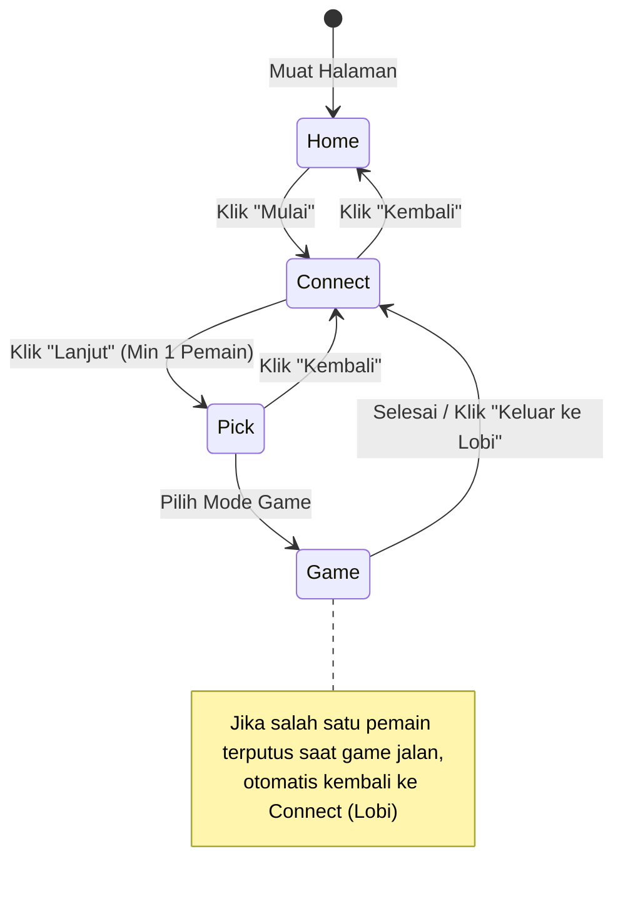

# Sektor 02: Shell & UI (`shell/app.js`, `shell/monitor.js`, `styles/app.css`)

Dokumen ini menguraikan arsitektur antarmuka pengguna (UI), alur navigasi layar (Screen State Machine), integrasi panel monitor masukan, standarisasi kanvas landscape, serta sistem desain platform.

---

## 1. Asumsi Produk & Lingkungan Penggunaan

Aplikasi dirancang khusus untuk lingkungan edukasi (sekolah, lab komputer, dan ruang kelas interaktif):
- **Orientasi Utama**: **Selalu Landscape**. Perangkat target mencakup:
  - **Layar PID (Panel Interaktif Digital)**: Layar sentuh besar 16:9 yang dilihat dari jarak jauh oleh seluruh siswa di kelas.
  - **Laptop & Komputer Lab**: Monitor standar widescreen.
  - **Tablet**: Layar tablet dalam posisi mendatar (landscape).
- **Daftar Resolusi Target & Uji Wajib**:
  1. `1920 × 1080` (Full HD 16:9 - Standar PID & Laptop modern)
  2. `2560 × 1440` (2K QHD 16:9 - Monitor resolusi tinggi)
  3. `1366 × 768` (Resolusi umum laptop edukasi)
  4. `1280 × 800` (Widescreen 16:10 - Laptop & tablet)
  5. `1024 × 768` (Aspect ratio 4:3 - Tablet klasik / iPad)
  6. `3840 × 2160` (4K UHD 16:9 - Layar PID generasi baru)
- **Deteksi Orientasi Portrait**:
  Bila perangkat berada dalam orientasi portrait (`@media (orientation: portrait)`), sistem menampilkan banner non-blocking di bagian atas: *"🔄 Putar perangkat ke mode landscape untuk tampilan terbaik"*. Banner bersifat pasif (`pointer-events: none`) sehingga tidak mengganggu interaksi pengguna.

---

## 2. Standarisasi Kanvas Landscape (1280 × 720)

Platform menetapkan resolusi kanvas standar **1280 × 720 px (16:9)**:
- **Toleransi Game Resolusi Berbeda**:
  Jika modul game lama mendeklarasikan resolusi selain 1280×720 (misalnya 600×800 portrait pada Ping Pong atau Endless Racer), shell tetap menjalankan game dengan sempurna:
  - Kanvas diskalakan secara proporsional (`object-fit: contain`) dengan latar panggung hitam/gelap (*letterbox* / *pillarbox*).
  - Shell mengeluarkan pesan peringatan diagnostik satu kali via `console.warn` berisi ID game dan dimensinya.
  - Backing store kanvas (`canvas.width` dan `canvas.height`) sepenuhnya dikelola oleh game itu sendiri melalui siklus hidup `create()`, shell tidak memotong atau mengubah ukuran backing store.
- **Ketajaman Visual**:
  Kanvas menerapkan CSS `image-rendering: -webkit-optimize-contrast; image-rendering: crisp-edges;` untuk menjaga ketajaman rendering piksel dan teks saat diperbesar pada layar proyektor/PID 4K.

---

## 3. Finite State Machine (Layar / Screens)

Navigasi aplikasi berbasis Single Page Application (SPA) tanpa reload, diatur oleh fungsi `show(screenName)`:



### Rincian Layar:
1. **`home` (#home)**:
   - Tampilan pembuka hero dengan judul besar dan tombol "Mulai".
   - Monitor masukan disembunyikan.
2. **`connect` (#connect)**:
   - Lobi koneksi pemain. Merender 4 slot pemain secara mendatar dalam 1 baris (layar lebar) atau 2 baris (layar < 900 px).
   - Seluruh konten dirancang muat dalam satu layar tanpa scroll window di 1366×768 dan 1024×768.
3. **`pick` (#pick)**:
   - Header dilengkapi badge status pemain yang sedang terhubung (`#pickPlayersBadge`) dengan pill warna pemain aktif.
   - Grid kartu game proporsional (3 kolom pada layar lebar/PID, 2 kolom pada tablet, 1 kolom pada ponsel).
   - Kartu game dirancang dengan header horizontal (ikon terbingkai rapi di samping judul dan badge pemain) serta deskripsi dengan tinggi seragam (`min-height`) agar seluruh kartu sejajar dan seimbang.
   - Tombol pemilihan mode pemain dibuat ringkas dan bersih (**1P**, **2P**, **3P**, **4P**) dengan target sentuh minimal 52 px, kontras tinggi, dan status *disabled* bergaya garis putus-putus transparan bila jumlah pemain belum mencukupi.
4. **`game` (#game)**:
   - Memenuhi seluruh viewport (`100vw × 100dvh`) tanpa margin, tanpa padding, dan `overflow: hidden` pada `body`.
   - Mengeliminasi scroll horizontal maupun vertikal.

---

## 4. Layout Arena Permainan (`.stage`) & Kontrol Overlay

Seluruh kontrol aksi ditempatkan **di dalam elemen `.stage`** agar tetap dapat diakses saat mode layar penuh (Fullscreen):

```
┌──────────────────────────────────────────────────────────────┐
│ [✕ Keluar]                                    [📡] [🔊] [⛶] │
│                                                              │
│                      CANVAS GAME                             │
│                  (1280x720 / contain)                        │
│                                                              │
│                                                              │
│                                              ┌─────────────┐ │
│                                              │ LACI        │ │
│                                              │ MONITOR     │ │
│                                              │ (Drawer     │ │
│                                              │  360px)     │ │
│                                              │             │ │
│                                              └─────────────┘ │
└──────────────────────────────────────────────────────────────┘
```

- **Jarak Aman Tepi**: Kontrol berjarak aman minimal 12 px dari batas tepi layar (`top: 12px; left: 12px;` dan `top: 12px; right: 12px;`).
- **Tombol Kiri Atas**:
  - `#quit`: Tombol keluar ke lobi. Menghentikan game dan kembali ke layar koneksi.
- **Tombol Kanan Atas**:
  - `#mon`: Tombol toggle laci monitor masukan (drawer).
  - `#snd`: Tombol mute/unmute audio.
  - `#fs`: Tombol layar penuh (Fullscreen API).
- **Spesifikasi Tombol**:
  - Ukuran target sentuh: Minimal `56 × 56 px`.
  - Kontras tinggi: Latar belakang gelap semi-transparan (`rgba(12,18,30,0.78)`), garis tepi putih tipis, dan efek blur (`backdrop-filter: blur(8px)`).
- **Layar Hasil Akhir (`#result`)**:
  - Berada di dalam `.stage` dengan latar overlay gelap transparan.
  - Teks hasil pertandingan menggunakan ukuran besar (`clamp(2rem, 5.5vw, 3.8rem)`) sehingga terbaca jelas dari baris belakang ruang kelas.

---

## 5. Panel Monitor Masukan & Laci Drawer

Panel monitor masukan (`shell/monitor.js`) melayani dua konteks tampilan tanpa menduplikasi DOM atau logika:
1. **Mode Non-Game (`#connect` dan `#pick`)**:
   - Tampil di bagian bawah halaman.
   - Ketinggian dibatasi maksimal `25vh` (`25dvh`) agar tidak mendorong konten utama dan tidak memicu scroll halaman pada laptop 1366×768.
2. **Mode In-Game (`#game`)**:
   - Tersembunyi secara default agar arena bermain bersih.
   - Elemen `#monitor` dipindahkan sementara ke dalam `.stage` dengan kelas `.drawer`.
   - Menekan tombol `#mon` akan menganimasikan laci overlay selebar **360 px** (maksimal 40% lebar layar) dari sisi kanan.
   - Laci dapat ditutup dengan:
     - Menekan tombol `#mon` kembali.
     - Menekan tombol `Esc` pada keyboard.
     - Menekan tombol silang `✕` (`#monClose`) di header laci.
   - Logika monitor (tombol Jeda, Bersihkan, auto-scroll) tetap bekerja 100% normal tanpa kebocoran memori.
   - Saat keluar dari game, elemen `#monitor` dikembalikan secara otomatis ke dalam wadah `<main>`.

---

## 6. Aturan Aksesibilitas & Sentuhan Jauh

1. **Target Sentuh**: Seluruh tombol, kontrol, dan kartu interaktif memiliki tinggi minimal **56 px** dan `touch-action: manipulation`.
2. **Tipografi**:
   - Base font-size diskalakan dinamis: `html { font-size: clamp(16px, 1.1vw, 24px); }`.
   - Teks isi/paragraf berukuran minimal **18 px** (`1.125rem`).
3. **Pencegahan Menu Konteks (Long-press)**:
   - Tombol, kanvas, dan panggung arena menonaktifkan menu konteks (`contextmenu` preventDefault dan `-webkit-touch-callout: none`) untuk mencegah pop-up browser yang tidak sengaja saat interaksi sentuh intens di layar PID.
4. **Bebas Ketergantungan Hover**:
   - Tidak ada elemen penting atau informasi yang tersembunyi di balik status `:hover`. Semua tombol dan navigasi terlihat permanen.
