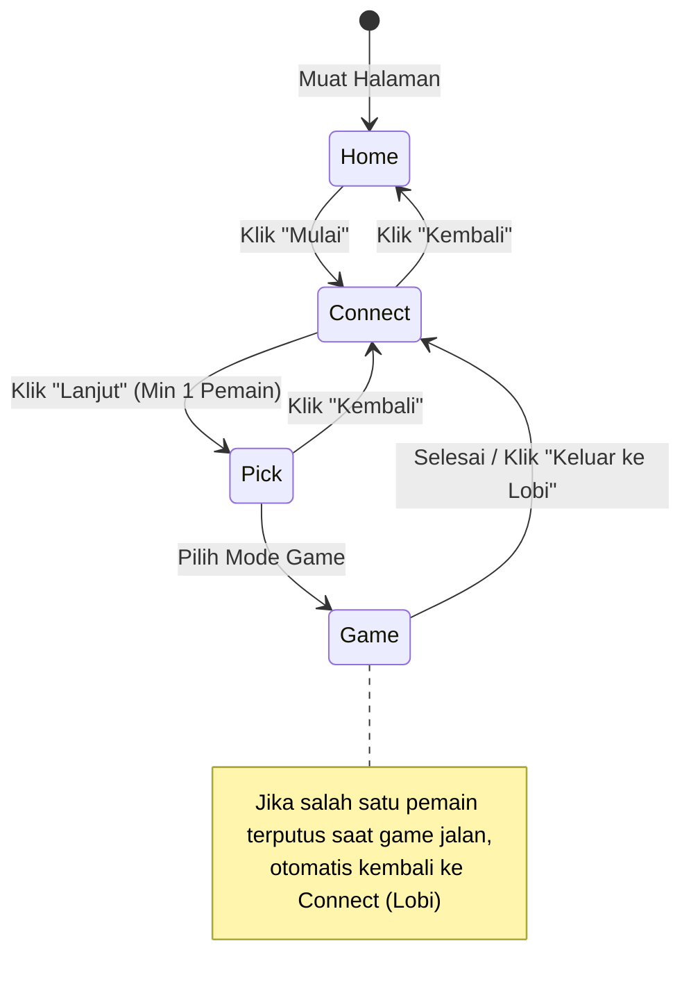

# Sektor 02: Shell & UI (`shell/app.js`, `shell/monitor.js`, `styles/app.css`)

Dokumen ini menguraikan arsitektur antarmuka pengguna (UI), alur navigasi layar (Screen State Machine), integrasi panel monitor masukan, serta sistem desain platform.

---

## 1. Peran & Prinsip Desain Shell

Shell adalah kerangka aplikasi tingkat atas (*application application wrapper*) yang bertugas:
- Menjembatani pengguna awam dengan perangkat keras micro:bit melalui instruksi visual yang jelas.
- Mengatur siklus hidup pergantian layar tanpa memutus sesi Bluetooth yang sedang aktif.
- Menyediakan fasilitas observabilitas (panel monitor log) untuk mempermudah instruktur/siswa memeriksa integritas transmisi data.
- Menampilkan pesan status, error handling BLE, serta hasil akhir permainan.

---

## 2. Finite State Machine (Layar / Screens)

Navigasi aplikasi berbasis Single Page Application (SPA) tanpa reload, diatur oleh fungsi `show(screenName)`:



### Rincian 4 Layar Utama:
1. **`home` (#home)**:
   - Tampilan penyambutan dengan judul aplikasi, ilustrasi, dan tombol tunggal "Mulai".
   - Panel monitor disembunyikan pada layar ini.
2. **`connect` (#connect)**:
   - Lobi koneksi pemain. Merender kartu slot sejumlah `Kernel.limit`.
   - Mengizinkan penambahan micro:bit via Web Bluetooth Picker atau tombol fallback Keyboard.
   - Menampilkan status koneksi, skema kontrol keyboard, dan preview perintah terakhir.
3. **`pick` (#pick)**:
   - Menampilkan katalog game yang terdaftar di `games/index.js`.
   - Setiap game menampilkan kartu dengan tombol mode (mis. "1 Player - Lawan komputer", "2 Player - Dua pemain berhadapan").
   - **Logika Validasi**: Tombol mode otomatis *disabled* jika jumlah pemain terhubung kurang dari `mode.players`.
4. **`game` (#game)**:
   - Arena permainan yang menampung elemen `<canvas id="cv">`.
   - Lapisan overlay hasil akhir (`#result`) untuk menampilkan pemenang dan tombol "Kembali ke lobi".
   - Tombol darurat "Keluar ke lobi" sewaktu-waktu.

---

## 3. Komponen Slot Dinamis (`renderSlots`)

Jumlah slot yang dirender tidak statis, melainkan adaptif mengikuti kebutuhan maksimum pemain dari semua game yang terdaftar:
```javascript
Kernel.limit = Math.min(MAX_PLAYERS, Math.max(...games.flatMap(g => g.modes.map(m => m.players))));
```
- Menjamin tampilan lobi tidak membingungkan pengguna dengan menampilkan 4 slot jika game yang tersedia hanya membutuhkan maksimal 2 pemain.
- Mendukung penanda warna unik per pemain (CSS variables `--p1`, `--p2`, `--p3`, `--p4`).

---

## 4. Panel Monitor Masukan (`shell/monitor.js`)

Panel monitor terletak di bagian bawah layar (tampil pada layar `connect`, `pick`, dan `game`). Panel ini adalah alat diagnostik krusial di lingkungan edukasi:

- **Logging Kategoris**:
  - `l-rx`: Data mentah dari micro:bit dalam representasi teks (karakter tak kasat mata diubah menjadi `↵` atau `␍`) dan deretan byte heksadesimal `[XX XX ...]`.
  - `l-cmd`: Perintah angka yang berhasil di-parse oleh kernel (warna hijau tegas).
  - `l-kb`: Perintah yang bersumber dari simulasi keyboard (warna aksen biru).
  - `l-tx`: Pesan balasan yang dikirim web ke micro:bit (warna oranye).
  - `l-warn`: Peringatan kegagalan atau status error BLE (warna merah).
- **Fitur Kontrol**:
  - Tombol **Jeda / Lanjutkan**: Menghentikan render log baru agar pengembang/guru dapat menginspeksi paket tanpa tergulung cepat.
  - Tombol **Bersihkan**: Mengosongkan riwayat container log.
  - Pembatasan memori DOM: Riwayat log otomatis dibatasi maksimal 150 entri elemen untuk menjaga performa rendering tetap ringan.

---

## 5. Sistem Desain & Styling (`styles/app.css`)

1. **Tipografi**:
   - Memakai font *Fredoka* (Google Fonts) dengan fallback sans-serif sistem, memberikan nuansa interaktif, ramah anak, dan modern.
2. **Skema Warna & Tema Otomatis**:
   - Mendukung Dark Mode dan Light Mode otomatis via media query `@media (prefers-color-scheme: dark)` serta atribut `data-theme`.
   - Palet warna konsisten:
     - Player 1: Biru (`#2f6df6` / `#6b9bff`)
     - Player 2: Oranye (`#e8800f` / `#ffa43a`)
     - Player 3: Hijau (`#12915a` / `#3ccf8e`)
     - Player 4: Ungu (`#8a4fd6` / `#b98cff`)
3. **Responsivitas & Safeties**:
   - Penggunaan `viewport-fit=cover` dan CSS environment variables `env(safe-area-inset-top)` untuk layar perangkat seluler/tablet dengan notch.
   - Aturan `@media (prefers-reduced-motion: reduce)` untuk aksesibilitas pengguna yang sensitif terhadap animasi.

---

## 6. Rencana Peningkatan Sektor Shell & UI

1. **Layar Hitung Mundur (Countdown 3-2-1)**:
   - Menambahkan overlay hitung mundur sebelum game dimulai untuk memberi waktu pemain bersiap memegang micro:bit.
2. **Audio Web Sound Effects (SFX)**:
   - Menambahkan efek suara di level browser menggunakan Web Audio API (suara tombol klik, hitung mundur, peluit kemenangan, dan peringatan putus koneksi).
3. **Mode Fullscreen (Layar Penuh)**:
   - Tombol toggle Fullscreen API di sudut kanan atas untuk pengalaman bermain arcade di layar proyektor atau TV kelas.
4. **Indikator Kualitas Sinyal & Baterai**:
   - Ikon sinyal Bluetooth dan ikon baterai pada masing-masing kartu slot pemain.

