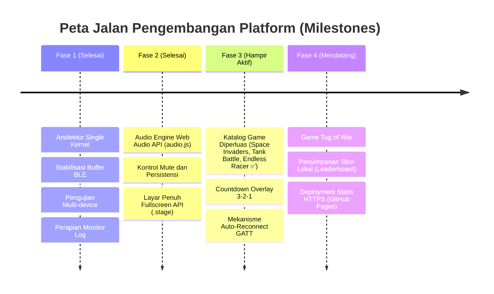

# Sektor 05: Roadmap Fitur & Rencana Pengembangan Masa Depan

Dokumen ini memetakan visi evolusi platform game micro:bit, mencakup perancangan game baru (termasuk game Tank 2v2), peningkatan kapabilitas platform, serta strategi penerapan di ruang kelas.

---

## 1. Rencana Game Baru

Sesuai filosofi arsitektur "Satu Kernel, Banyak Game", penambahan game baru dapat dilakukan tanpa mengubah kode inti Bluetooth. Berikut adalah garis besar judul game beserta status implementasinya:

> **Status terkini (per dokumen `06-games-catalog.md`):** Game **Space Invaders**, **Tank Battle**,
> **Endless Racer**, **Dino Jump**, dan **Flappy Bird** telah terdaftar aktif di `games/index.js`.
> Fokus rencana baru berpindah ke game yang belum ada (Maze, Tug of War, Space Dodge/Meteor Survival, dst).

---

### 1.1 Game: Flappy Bird (Multiplayer Shared Arena) — ✅ Terimplementasi

*Game Flappy Bird aktif bernama `flappybird` — lihat `plan/games/flappybird.md`.*

- **Konsep**: Semua burung terbang bersama di satu arena melewati celah pipa ber-seed RNG.
- **Kebutuhan Slot**: 1 sampai 4 Pemain (`players: 1..4`).
- **Skema Kontrol**:
  - `5#`, `3#`, atau `4#`: Flap / terbang (panah kiri/kanan atau A/D pada keyboard).
  - `99#`: Mulai (hanya dari pemain pertama `players[0]`, atau klik kanvas).
- **Fitur Khusus**: Antarmuka bersih tanpa menu opsi; paten 3 nyawa dan berlangsung sampai semua pemain gugur agar siswa dapat menikmati permainan secara maksimal.

---

### 1.2 Game: Maze Race (Labirin Petualangan) — 📝 Spesifikasi Selesai (Siap Diimplementasi)

*Dokumentasi spesifikasi lengkap: lihat [plan/games/maze.md](games/maze.md).*

- **Konsep**: Permainan adu cepat eksplorasi labirin multi-pemain (1–4 pemain) dalam satu layar bersama.
- **Fitur Unggulan**:
  - **Labirin Simetris 4-Kuadran (*4-Way Quadrant Symmetry*)**: Menjamin *100% Fair Play* di mana jarak langkah, jumlah belokan, sebaran kristal, dan rintangan dari setiap sudut pemain menuju pusat labirin identik dan setara.
  - **Sistem 3 Babak Bertingkat (*Best of 3 Rounds*)**: Ronde 1 (Easy), Ronde 2 (Medium), dan Ronde 3 (Final Hard) dengan akumulasi poin.
  - **Elemen Interaktif**: Kristal energi (+50 pts, speed boost), laser kejut (stun 1 detik), dan Portal Inti di pusat labirin.
- **Kebutuhan Slot**: 1 sampai 4 Pemain (`players: 1..4`).
- **Skema Kontrol**: Standar sinyal 4-arah (`1#` Atas, `2#` Bawah, `3#` Kiri, `4#` Kanan, `0#` Berhenti, `99#` Mulai).
- **Status**: Spesifikasi desain tuntas disetujui, siap diimplementasikan di `games/maze.js`.

---

### 1.3 Game: Tug of War (Tarik Tambang - Shake Battle)
- **Konsep**: Permainan pesta berenergi tinggi. Pemain mengocok/menggoyang micro:bit secepat mungkin untuk menarik tambang ke sisi timnya.
- **Kebutuhan Slot**: 2 hingga 4 Pemain.
- **Skema Kontrol micro:bit**:
  - micro:bit mendeteksi `on shake` dan mengirim pulsa `1#`.
  - Kernel menghitung akumulasi frekuensi getaran per detik (RPM).
- **Fitur Khusus**: Sangat cocok untuk demonstrasi cepat di kelas karena tidak memerlukan pemahaman koordinasi tombol rumit.

---

### 1.3 Game: Space Dodge / Meteor Survival
- **Konsep**: Pemain mengendalikan pesawat luar angkasa menggunakan tilt/kemiringan untuk menghindari hujan asteroid yang kecepatannya bertambah seiring waktu.
- **Kebutuhan Slot**: 1 Player (Solo Highscore) atau 2 Player (Co-op bertahan bersama).
- **Skema Kontrol micro:bit**:
  - Kemiringan kiri/kanan (`3#` / `4#`) dan tombol booster kecepatan (`1#`).

---

## 2. Peningkatan Fitur Platform & Shell

> **Catatan Fase 3**: Game **Space Invaders**, **Tank Battle**, dan **Endless Racer** telah terdaftar di
> `games/index.js` dan didokumentasikan di `06-games-catalog.md`. Yang masih berjalan dari fase ini:
> **Countdown Overlay 3-2-1** dan **Auto-Reconnect GATT**.

### 2.1 Web Audio FX di Tingkat Browser (Telah Terimplementasi)
Efek audio telah diintegrasikan sepenuhnya menggunakan sintesis `Web Audio API` melalui modul `core/audio.js` (bebas aset file eksternal) dengan kontrol volume/mute `#snd` dan persistensi `localStorage`:
- [x] Suara *bip* pantulan dinding (`bounce`) dan pukulan paddle (`hit`) dengan panning spasial stereo.
- [x] Efek suara skor bertambah (`score`) serta kemenangan/kekalahan (`win` / `lose`).
- [x] Resep efek deklaratif untuk game masa depan (`shoot`, `explode`, `hurt`, `powerup`, `start`, `click`).

### 2.2 Mode Layar Penuh / Fullscreen API (Telah Terimplementasi)
- [x] Tombol `#fs` pada panggung `.stage` yang mempertahankan aspek rasio $3:4$ dengan `object-fit: contain` dan menyertakan overlay pemenang `#result`.

### 2.2 Mekanisme Auto-Reconnect GATT yang Cerdas
- Mengimplementasikan pendengar event `gattserverdisconnected`.
- Jika micro:bit terputus saat pertandingan berlangsung, game otomatis berada dalam status **Jeda Darurat** (*Emergency Pause*), dan browser mencoba menyambung ulang perangkat selama 15 detik sebelum membatalkan pertandingan.

### 2.3 Sistem Penyimpanan Skor & Statistik (LocalStorage)
- Menyimpan rekor kemenangan terbanyak (Win Streaks) atau skor tertinggi per sesi tanpa membutuhkan backend/database server.
- Menyediakan tombol reset riwayat di layar lobi.

---

## 3. Strategi Pengujian & Penggunaan di Kelas (Deployment Guide)

### 3.1 Protokol Keamanan Web Bluetooth
- Web Bluetooth mewajibkan konteks aman (**HTTPS** atau `http://localhost`).
- **Rekomendasi Hosting**: Deploy repositori ini secara otomatis menggunakan **GitHub Pages**, Cloudflare Pages, atau Vercel. Pengajar cukup membuka URL statis tersebut di proyektor kelas tanpa instalasi server lokal.

### 3.2 Matriks Kompatibilitas Browser & Perangkat

| Perangkat & Sistem Operasi | Peramban (Browser) | Status Dukungan |
|---|---|---|
| Windows 10/11 | Google Chrome / Microsoft Edge | **Didukung Penuh** (Direkomendasikan) |
| macOS | Google Chrome / Microsoft Edge | **Didukung Penuh** |
| ChromeOS (Chromebook) | Chrome bawaan | **Didukung Penuh** (Sangat ideal untuk sekolah) |
| Android Tablet / Smartphone | Chrome for Android | Didukung (Kebutuhan HTTPS aktif) |
| iOS / iPadOS | Safari / Semua browser | *Tidak Didukung* (Apple membatasi Web Bluetooth) |

### 3.3 Checklist Uji Stabilitas 4 micro:bit Sekaligus
Sebelum menggelar turnamen 4 pemain (Tank Battle):
1. Pastikan adaptor Bluetooth komputer host minimal mendukung **Bluetooth 4.2 / 5.0** (BLE Multi-connection).
2. Hindari tumpukan gelombang radio 2.4GHz yang terlalu padat (misal hotspot Wi-Fi berjarak sangat dekat dengan micro:bit).
3. Beri label nomor stiker fisik pada setiap micro:bit (P1, P2, P3, P4) agar tidak tertukar saat siswa mengambil perangkat.

