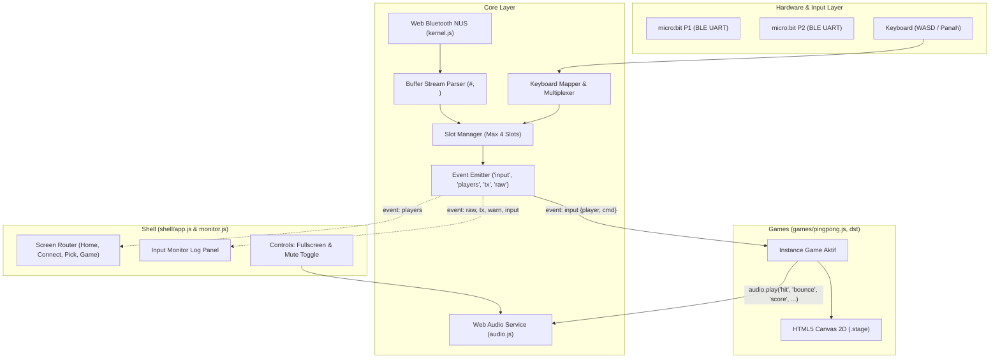

# Dokumentasi & Rencana Pengembangan: Platform Game micro:bit

Dokumentasi ini menyajikan arsitektur, spesifikasi teknis, serta rencana pengembangan platform interaktif game berbasis browser dengan kendali BBC micro:bit melalui koneksi Web Bluetooth (BLE UART).

---

## 1. Ikhtisar Proyek

Platform ini menerapkan filosofi **"Satu Kernel, Banyak Game"** (*Single Kernel, Multi-game Platform*):
- **Zero Reconnection**: micro:bit dihubungkan satu kali di layar lobi. Pemain dapat berpindah antar game tanpa perlu memutuskan atau memasangkan ulang BLE.
- **Pemisahan Peran yang Bersih**:
  - `core/kernel.js`: Bertindak sebagai *hardware abstraction layer* dan pengelola input. Bebas dari logika game dan aturan tampilan.
  - `shell/`: Mengelola alur layar (State UI), lobi pemain, pemilih game, dan panel monitor serial/debugging.
  - `games/`: Berisi modul game yang independen, hanya berinteraksi melalui antarmuka standar (*game contract*).
- **Aksesibilitas Dual-Input**: Mendukung micro:bit nirkabel sekaligus keyboard virtual untuk pengujian mudah dan cadangan tanpa perangkat fisik.

---

## 2. Struktur Direktori Proyek

```
microbit-games/
├── index.html              # Entry point HTML, navigasi layar, tombol fullscreen & audio
├── styles/
│   └── app.css             # Desain UI tema terang/gelap, layout lobi, kanvas & monitor
├── core/
│   ├── kernel.js           # BLE Web Bluetooth, parser UART, event bus, manajemen slot
│   └── audio.js            # Layanan efek suara Web Audio API (disintesis, pan, envelope)
├── shell/
│   ├── app.js              # State machine layar, rendering slot, fullscreen, audio toggle
│   └── monitor.js          # Terminal log real-time (RX, TX, Command, Error)
├── games/
│   ├── index.js            # Registry daftar game yang aktif
│   └── pingpong.js         # Implementasi game Ping Pong (1P & 2P)
├── plan/                   # Dokumentasi master plan & sektor teknis
│   ├── README.md           # Dokumen master indeks & ringkasan rencana
│   ├── 01-core-kernel.md   # Spesifikasi Core Kernel & Lapisan BLE
│   ├── 02-shell-and-ui.md  # Spesifikasi Shell UI, UX, & Terminal Monitor
│   ├── 03-game-system.md   # Spesifikasi Kontrak Game, Loop, & Katalog Game
│   ├── 04-firmware-microbit.md # Spesifikasi Firmware MakeCode & Komunikasi UART
│   ├── 05-future-roadmap-and-features.md # Roadmap Fitur Masa Depan & Game Baru
│   ├── 06-games-catalog.md # Indeks & Ringkasan Katalog Game
│   └── games/              # Dokumentasi individual per game
│       ├── pingpong.md     # Ping Pong
│       ├── spaceinvaders.md# Space Invaders
│       ├── tankbattle.md   # Tank Battle
│       └── endlessracer.md # Endless Racer
└── README.md               # Panduan cepat menjalankan proyek
```

---

## 3. Peta Dokumen Sektor

Setiap sektor didokumentasikan secara mandiri dan mendalam di dalam folder ini:

| File Sektor | Fokus & Cakupan |
|-------------|-----------------|
| [01-core-kernel.md](01-core-kernel.md) | Analisis Web Bluetooth API, Nordic UART Service (NUS), buffer chunking, parser token `N#`, keyboard emulator fallback, penanganan disconnect, dan optimasi latency. |
| [02-shell-and-ui.md](02-shell-and-ui.md) | Manajemen state tampilan layar (`home`, `connect`, `pick`, `game`), dynamic slot UI, validasi syarat pemain mode game, monitor RX/TX real-time, tema warna, dan adaptasi responsif. |
| [03-game-system.md](03-game-system.md) | Standar *Game Contract API* (`create`, `stop`, `finish`), lifecycle render loop canvas 2D, integrasi input event, sistem fisika pingpong saat ini, dan standarisasi pembuatan game berikutnya. |
| [04-firmware-microbit.md](04-firmware-microbit.md) | Konfigurasi MakeCode micro:bit v1/v2, mapping tombol & akselerometer (gesture tilt) ke perintah `0#`-`9#`, penanganan feedback haptic/audio RX (`!#`), dan panduan troubleshooting flashing. |
| [05-future-roadmap-and-features.md](05-future-roadmap-and-features.md) | Rencana pengembangan game baru (Tank Battle 2v2, Tug of War, Maze Runner), Web Audio FX di browser, fitur auto-reconnect BLE, export/save telemetry log, dan persiapan untuk deployment kelas. |
| [06-games-catalog.md](06-games-catalog.md) | Indeks & ringkasan katalog game aktif; menautkan ke dokumentasi individual tiap game di `plan/games/`. |
| [games/](games/) | Dokumentasi **individual** per game: `pingpong.md`, `spaceinvaders.md`, `tankbattle.md`, `endlessracer.md` (mode, kontrol, mekanik, fisika, audio). |

---

## 4. Alur Kerja Sistem (System Dataflow)



---

## 5. Ringkasan Prinsip Desain

1. **Modularitas Mutlak**: Game tidak boleh mengimpor modul Bluetooth langsung atau mengubah DOM di luar elemen `<canvas>` dan trigger `finish()`.
2. **Deterministic Commands**: Komunikasi satu arah micro:bit ke kernel menggunakan angka terdefinisi ringkas (`0#` s.d. `9#`), di mana semantik arti angka diatur oleh masing-masing game.
3. **Resilient Communication**: Kernel menangani pemotongan paket data BLE (fragmentasi MTU 20-byte) dan memulihkan teks melalui buffer parser yang aman.
4. **Developer & Classroom Friendly**: UI dilengkapi monitor log heksadesimal dan teks mentah agar guru/siswa dapat memverifikasi micro:bit tanpa alat eksternal.

