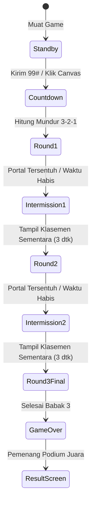

# Game: Maze Race (Labirin Petualangan)

| Atribut | Nilai |
|---|---|
| **`id`** | `maze` |
| **Nama** | Maze Race |
| **Ikon** | 🧭 |
| **File** | `games/maze.js` |
| **Dokumen induk** | [06-games-catalog.md](../06-games-catalog.md) |

Permainan arkade penjelajahan dan adu cepat memecahkan labirin multi-pemain (1 sampai 4 pemain) dalam satu layar bersama (*shared screen*). Semua pemain mengendalikan robot penjelajah ROBOPANDA secara simultan di satu arena labirin yang sama tanpa saling bertabrakan atau memblokir.

Game ini mengusung **dua pilar desain utama**:
1. **Labirin Simetris 4-Kuadran Sempurna (*4-Way Quadrant Symmetry*)**: Menjamin *100% Fair Play* di mana jarak langkah, jumlah belokan, sebaran kristal, dan rintangan dari setiap sudut pemain menuju pusat labirin identik dan setara.
2. **Sistem 3 Babak Bertingkat (*Best of 3 Progressive Rounds*)**: Permainan berjalan dalam 3 ronde berenergi tinggi dengan tantangan bertahap, memberikan kesempatan *comeback* dan perebutan juara yang seru di babak final.
3. **Antarmuka Bersih Tanpa Opsi**: Mengikuti standar lobi ROBOPANDA, kartu game tampil rapi dengan tombol langsung **1P**, **2P**, **3P**, dan **4P**.

---

## Mode Permainan

| `id` | Label | Sub | `players` | Penjelasan |
|---|---|---|---|---|
| `1p` | 1 Player | Solo Time Attack | 1 | Berpacu menyelesaikan labirin dan mengumpulkan kristal sebelum waktu habis |
| `2p` | 2 Player | Duel Sudut | 2 | P1 (Kiri-Atas) vs P2 (Kanan-Atas) adu cepat menuju pusat |
| `3p` | 3 Player | Segitiga Laga | 3 | P1, P2, dan P3 bersaing memperebutkan skor ronde tertinggi |
| `4p` | 4 Player | 4-Sudut Penuh | 4 | Seluruh 4 sudut terisi, kompetisi penuh layar kelas |

---

## Spesifikasi Teknis

| Aspek | Nilai | Keterangan |
|---|---|---|
| **Canvas** | `1280 × 720 px` | Rasio 16:9 standar landscape PID sekolah / laptop |
| **Jumlah Ronde** | `3 Ronde` | Ronde 1 (Easy), Ronde 2 (Medium), Ronde 3 (Final Hard) |
| **Durasi per Ronde** | `60 detik` | Waktu mundur (*Countdown Timer*) di setiap ronde |
| **Grid Labirin** | `29 kolom × 17 baris` | Sel berukuran `36 × 36 px`, terpusat rapi di tengah arena |
| **Algoritma Generator** | *Seeded DFS with 4-Way Reflection* | Meng-generate 1 kuadran lalu dicerminkan ke 3 kuadran lainnya |
| **Kecepatan Karakter** | `185 px/dtk` | Pergerakan halus (*smooth continuous movement*) |
| **Corner Assist Buffer** | `8 px` | Toleransi belokan agar karakter tidak tersangkut di sudut persimpangan |
| **Ukuran Robot** | `24 × 24 px` | Digambar bentuk canvas robot penjelajah dengan antena dan lampu LED |
| **Hitbox Tabrakan** | `20 × 20 px` (Toleransi) | Memudahkan manuver di lorong 36 px dan kompensasi latensi nirkabel BLE |
| **Warna Pemain** | P1 `#4b83ff`, P2 `#ff9a2e`, P3 `#3ccf8e`, P4 `#b98cff` | Mengikuti **nomor slot fisik**, bukan urutan array |
| **Area Bebas HUD** | `40 px` dari tepi atas | Mencegah tumpang tindih dengan tombol overlay panggung (`#quit`, `#mon`, `#snd`, `#fs`) |

---

## Kontrol & Pemetaan

Menggunakan standar sinyal 4-arah Kernel ROBOPANDA:

| Perintah | Aksi | micro:bit | Keyboard P1 | Keyboard P2 |
|---|---|---|---|---|
| **Mulai Permainan** | Masuk hitung mundur 3-2-1 | `99#` (Pemain 1) | Klik Kanvas / Enter | - |
| **Maju / Atas** | Robot bergerak ke atas | `1#` | Panah Atas (`↑`) | Tombol `W` |
| **Mundur / Bawah** | Robot bergerak ke bawah | `2#` | Panah Bawah (`↓`) | Tombol `S` |
| **Belok Kiri** | Robot bergerak ke kiri | `3#` | Panah Kiri (`←`) | Tombol `A` |
| **Belok Kanan** | Robot bergerak ke kanan | `4#` | Panah Kanan (`→`) | Tombol `D` |
| **Berhenti** | Robot berhenti di tempat | `0#` | Lepas Tombol | Lepas Tombol |

*Catatan Mekanisme Kendali*: Karakter meluncur mengikuti arah terakhir yang ditekan sampai membentur dinding atau menerima perintah arah lain / perintah `0#`.

---

## Desain Labirin Simetris 4-Kuadran (*4-Way Symmetry*)

```
┌─────────────────┬─────────────────┐
│                 │                 │
│   KUADRAN 1     │   KUADRAN 2     │
│   (Spawn P1)    │   (Spawn P2)    │
│   [Kiri-Atas]   │   [Kanan-Atas]  │
│                 │                 │
│        \        │        /        │
│         \       │       /         │
├───────────[ 🏆 PORTAL ]───────────┤
│         /   (Tengah)    \         │
│        /        │        \        │
│                 │                 │
│   KUADRAN 3     │   KUADRAN 4     │
│   (Spawn P3)    │   (Spawn P4)    │
│   [Kiri-Bawah]  │   [Kanan-Bawah] │
│                 │                 │
└─────────────────┴─────────────────┘
```

1. **Prinsip Simetri**:
   - Peta berukuran ganjil `29 × 17` sel sehingga memiliki tepat 1 sel pusat di `(14, 8)`.
   - Generator labirin membangun jalur dari pusat keluar menuju kuadran kiri-atas `[0..13, 0..7]`.
   - Struktur dinding, lorong, dan jalan buntu kuadran tersebut dicerminkan secara horizontal dan vertikal ke 3 kuadran lainnya.
2. **Keadilan Absolut**:
   - Jarak tempuh langkah optimal dari titik start `(1, 1)`, `(27, 1)`, `(1, 15)`, dan `(27, 15)` ke Portal Pusat `(14, 8)` adalah **persis sama**.
   - Setiap pemain menghadapi jumlah tikungan dan jalan buntu yang setara.

---

## Progresi 3 Babak (Level)

| Ronde | Karakteristik Labirin | Kristal Energi | Rintangan Laser | Bonus Juara Portal |
|---|---|---|---|---|
| **Ronde 1 (Easy)** | Lorong lebih terbuka, banyak jalan tembus | 12 Kristal (+50 pts) | Tidak Ada | +300 Poin |
| **Ronde 2 (Medium)** | Lorong standar, percabangan mengecoh | 16 Kristal (+50 pts) | 4 Laser Berdenyut | +400 Poin |
| **Ronde 3 (Final)** | Labirin penuh, banyak jalan buntu taktis | 20 Kristal (+50 pts) | 8 Laser Berdenyut | +500 Poin |

---

## Elemen Interaktif Arena

1. **Portal Inti / Goal (🏆)**:
   - Terletak di pusat labirin sel `(14, 8)` dengan efek cahaya berputar (*rotating portal glow*).
   - Pemain pertama yang menyentuh portal mendapatkan **Bonus Juara Portal** dan ronde langsung selesai (atau pemain lain diberi waktu sisa 5 detik untuk mengamankan poin).
2. **Kristal Energi ROBOPANDA (♦)**:
   - Tersebar simetris di persimpangan lorong.
   - Memberi **+50 Poin** saat diambil dan efek suara `'point'`.
   - Mengambil kristal memberi pemain dorongan kecepatan sesaat (*Speed Boost +15%*) selama 1,5 detik.
3. **Pagar Laser Kejut (⚡)**:
   - Rintangan laser yang berdenyut (aktif 2 detik, mati 2 detik).
   - Jika robot terkena laser saat menyala:
     - Robot mengalami *stun* 1 detik (tidak bisa bergerak) dan berkedip.
     - Memutar audio `'hurt'`.
     - Robot **tidak mati permanen**, sehingga siswa tetap bisa melanjutkan permainan tanpa rasa frustrasi.

---

## Alur Permainan (*Game Loop*)



1. **Fase Standby (`waiting`)**:
   - Robot melayang pelan di sudut masing-masing.
   - Tampil teks panduan: *"Kirim 99# dari micro:bit pemain pertama (P{slot}), atau klik layar untuk mulai!"*.
2. **Hitung Mundur (`countdown`)**:
   - Hitung mundur `3 → 2 → 1` dengan audio `click`.
3. **Gameplay Ronde 1..3**:
   - Kontrol aktif, waktu mundur dari 60 detik.
   - Pemain dapat saling berpapasan (*no collision between players*).
4. **Jeda Antar Ronde (*Intermission*)**:
   - Menampilkan banner selebrasi pemenang ronde dan klasemen skor sementara selama 3,5 detik.
   - Meng-generate peta simetris baru untuk ronde berikutnya.
5. **Hasil Akhir (`finish`)**:
   - Di akhir Ronde 3, skor total dihitung.
   - Memanggil `finish(hasilTeks)` dengan format podium juara yang megah dan terbaca jelas dari jauh di layar PID kelas.

---

## Format Hasil Akhir (`finish`)

- **1 Player (Solo)**:  
  `"Selesai! Skor Akhir: {skor} Poin | Kristal Terkumpul: {totalKristal}"`
- **Multiplayer (Menang Tunggal)**:  
  `"Player {n} Juara Labirin ROBOPANDA! 🏆\nSkor: P1={s1} | P2={s2} | P3={s3} | P4={s4}"`
- **Multiplayer (Seri)**:  
  `"Pertandingan Seri! 🤝\nSkor Tertinggi Bersama: {skor} Poin"`

